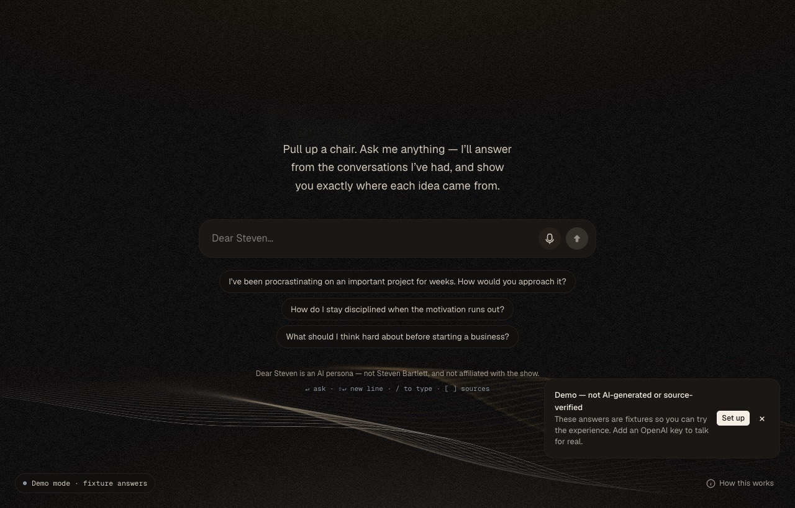
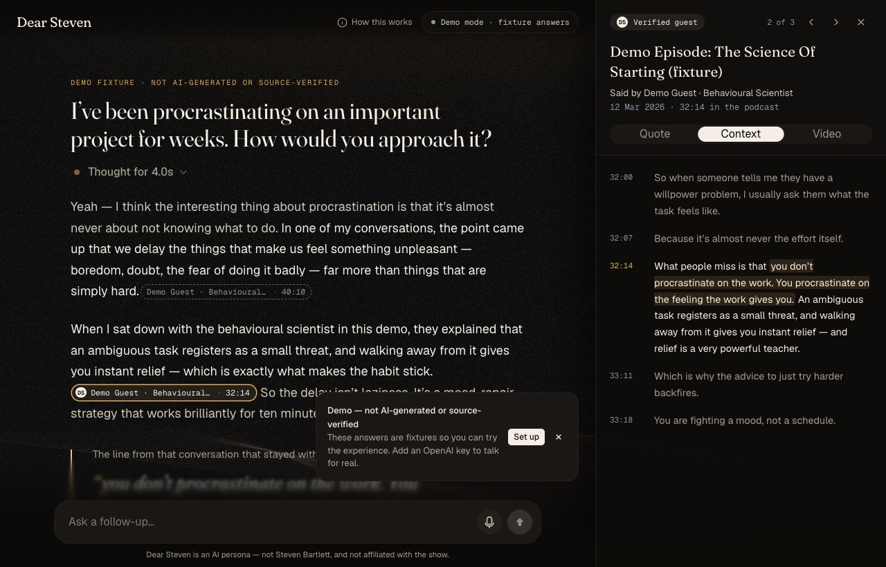
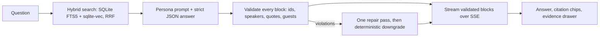

# Dear Steven

**Ask Steven a real question and get a thoughtful first-person answer whose every claim you can click through to the exact moment it was said.**

Dear Steven is an AI persona inspired by Steven Bartlett's interview style on *The Diary Of A CEO*. It answers in the first person, but its knowledge is a local index of real episode transcripts, and every claim it attributes to anyone links to the passage it came from. It is an independent, non-commercial fan project. It is **not** Steven Bartlett and is not affiliated with the show.





<sub>Screenshots are from demo mode: the guests, episodes and quotes are labelled fixtures.</sub>

## What makes it different

- **The model never writes citations.** It returns a structured answer. The server checks every citation against the passages it actually retrieved before the browser sees a word.
- **Quotes come from the transcript, not the model.** A pull quote is located in the stored transcript, and the UI shows the stored span, so what's on screen is always exactly what was transcribed.
- **Four kinds of statement, kept apart:**
  - Something the host verifiably said (an ember chip).
  - Something a guest verifiably said (an ivory chip with the guest's initial).
  - A real passage where the speaker isn't verified (a dashed chip).
  - The persona's own reasoning (softer text, no chip).
- **It says when it doesn't know.** If the conversations don't cover your question, the answer says so.
- **Click any chip** to see the verbatim passage, who said it, the surrounding transcript, why it was cited, and a link to the YouTube moment.

## Quick start (no keys needed)

```bash
pnpm install
pnpm dev            # http://localhost:3000, in demo mode with labelled fixture answers
```

You need Node ≥ 22.18 and pnpm 10. Demo mode shows the full experience (home, streaming answers, citation chips, the evidence drawer, voice), and it is labelled as a demo everywhere.

## Real answers from real episodes

```bash
cp .env.example .env              # add OPENAI_API_KEY (and optionally YOUTUBE_API_KEY)
pnpm ingest all --limit 20        # the 20 newest episodes: free RSS transcripts, chunked, embedded
pnpm dev
```

Prefer the browser? `pnpm dev:setup` prints a one-time link; its setup panel saves your keys, fetches the transcripts, shows what embedding will cost before you click, and links the videos.

`pnpm ingest all` reads the publisher's official RSS feed, fetches the free VTT transcripts it lists, splits them into passages, embeds them (about $0.02 for 20 episodes), and links each episode to its YouTube video when a YouTube key is set. Keyword search works the moment passages exist, even without an OpenAI key. Run `pnpm ingest status` at any time to see what's indexed and what to run next.

RSS transcripts have no speaker labels, so citations from them are credited to the *conversation*, never to a person. To get verified host and guest statements, you can run a paid, budget-capped diarized transcription:

```bash
pnpm ingest transcribe --diarize --budget 5 --host-clip data/voiceprints/steven.wav --limit 10
```

See `docs/INGESTION.md` and `plan/human/transcription-budget.md` first.

## Talking to it

Press **M**, or click and hold the microphone, to ask by voice.
- Chrome, Edge and Safari use their built-in speech recognition. Firefox records and sends the audio to the server.
- Spoken replies use a stock OpenAI voice, or the browser's own voice, and play only after a spoken question or when you press **Listen**.
- The microphone is only opened while you hold or toggle it.

Keyboard shortcuts:

| Key | Action |
|-----|--------|
| `/` | Focus the composer |
| `M` | Start or stop talking |
| `]` / `[` | Next or previous source |
| `Esc` | Cancel listening, stop speaking, or close the inspector |

## How it works



- `apps/web` is a Next.js 16 app: a thin server shell with route handlers, plus one client-side stage built with React Bits components.
- `packages/core` holds every domain decision: schemas, the SQLite knowledge store, retrieval, the persona, answer composition and citation validation. It is framework-free and fully unit-tested.
- `packages/ingest` is the CLI that builds the knowledge base. It runs on your machine, never in the web process.
- Everything lives in one SQLite file (`data/dear-steven.db`), which is gitignored.

The details are in `docs/ARCHITECTURE.md`, and the reasons behind each choice are in `plan/12-adr/`.

## Commands

| Command | What it does |
|---------|--------------|
| `pnpm dev` | Run the app (demo mode without a key) |
| `pnpm dev:setup` | Run the app on this machine only, with the guided setup in its setup panel |
| `pnpm check` | Lint, typecheck, unit tests and architecture rules; must pass before every PR |
| `pnpm e2e` | Playwright end-to-end tests (desktop + mobile, demo mode) |
| `pnpm ingest <command>` | Build the knowledge base (`pnpm ingest help`) |
| `pnpm eval` | Retrieval recall@10 on the seed questions (`--answers` adds full answers; needs a key) |
| `pnpm build && pnpm start` | Production build |

## Deploying

Build the image with `docker build -t dear-steven .`. It runs as a single container with the knowledge base on a mounted volume; see `docs/DEPLOY.md`. Serverless hosts (for example Vercel) are not a target while the knowledge base is a local SQLite file.

## Rights, privacy and takedowns

Dear Steven is an independent, non-commercial fan project: an AI persona, not Steven Bartlett, and
not affiliated with, endorsed by or speaking for him, The Diary Of A CEO or FlightStory. Answers can
be wrong and are not professional advice; it comes with no warranty. Please watch the full
conversations on [The Diary Of A CEO's YouTube channel](https://www.youtube.com/channel/UCGq-a57w-aPwyi3pW7XLiHw)
and support the show. The details: [`DISCLAIMER.md`](DISCLAIMER.md), [`TERMS.md`](TERMS.md) and
[`PRIVACY.md`](PRIVACY.md), also shown in the app at `/terms`.

- No transcripts, audio or embeddings are in this repository. Each installation builds its own knowledge base from the publisher's public RSS feed.
- The app shows short, attributed quotations with links to the original episode. It never publishes a transcript.
- Questions are not stored. Answer logging is off unless you set `DEAR_STEVEN_LOG_ANSWERS=1`.
- **Takedown requests:** if you hold the rights to an episode, appear in one, or have another good reason to want something removed, ask and it will be removed. Contact: **TODO (owner) — a contact address will be published here** (see [`TERMS.md`](TERMS.md)).
- To remove an episode from your own copy, run `pnpm ingest purge <episode> --yes`. It deletes the transcript, passages, embeddings and cached audio.

## Contributing

This repository is built to be worked on by people and coding agents alike. Start with `AGENTS.md`, then `plan/STATUS.md` for the next issue.

## License

[PolyForm Noncommercial 1.0.0](LICENSE): you may read, run, change and share Dear Steven for any
noncommercial purpose — personal use, study, research, hobby projects, charities, schools. You may
not sell it or use it to make money. The vendored React Bits components keep their own licence
(MIT + Commons Clause), and third-party packages keep theirs. See [`NOTICE`](NOTICE).
